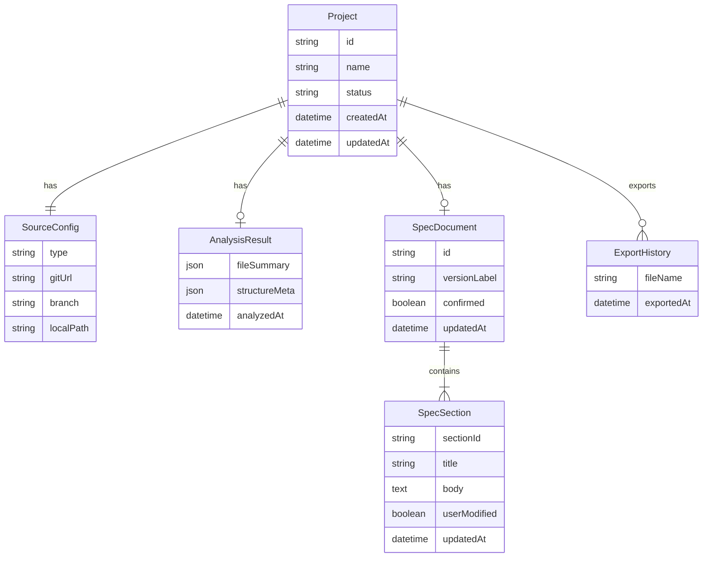

# 프로그램 사양서 웹 시스템 — 기능 정의서

| 항목 | 내용 |
|------|------|
| 문서명 | 프로그램 사양서 웹 시스템 기능 정의서 |
| 버전 | 1.0 |
| 작성일 | 2026-03-28 |
| 상태 | 초안 |

---

## 1. 개요

### 1.1 목적

로컬 또는 Git 저장소의 소스코드를 읽어 **프로그램 사양서 초안을 AI로 생성**하고, 웹에서 필요한 부분을 수정한 뒤 **Word(`.docx`) 문서로 다운로드**할 수 있는 시스템을 정의한다.

본 문서는 구현 전 요구사항·기능의 기준 문서이며, 이후 설계·개발·테스트의 추적 단위로 사용한다.

### 1.2 대상 사용자

| 역할 | 설명 |
|------|------|
| 개발자 | 소스 기반 사양서 초안을 빠르게 확보하고 보완한다. |
| 분석가/문서 담당 | 생성된 초안을 검수·수정하여 공식 사양서로 정리한다. |

1차 범위는 **로컬(또는 온프레미스) 단일 사용자·소규모 팀** 사용을 전제로 한다. 다중 사용자 로그인·권한은 후속 범위로 둔다.

### 1.3 확정된 제품 범위

| 항목 | 결정 |
|------|------|
| 소스 입력 | Git 저장소 URL **또는** 로컬 경로 |
| 대상 언어/파일 | Java (`.java`), Vue (`.vue`), XML (`.xml`) |
| 초안 생성 | AI 기반 |
| 편집 | 웹 UI에서 섹션 단위 수정 |
| 내보내기 | Word (`.docx`) |

### 1.4 범위 In / Out

#### In (1차)

- 사양서 작업(프로젝트) 생성·목록·선택
- Git URL / 로컬 경로로 소스 입력
- Java·Vue·XML 수집 및 구조 분석(전처리)
- AI 사양서 초안 생성·섹션/전체 재생성
- 웹 편집·임시 저장·확정
- Word 다운로드
- 진행 상태·오류 안내

#### Out (1차 비범위)

- PDF / Markdown 내보내기
- 다중 사용자 계정·역할·권한
- 소스 변경 diff 기반 자동 재생성
- 사양서 템플릿 완전 커스터마이즈 UI
- IDE 플러그인·브라우저 확장

---

## 2. 전체 흐름

| 단계 | 이름 | 설명 |
|------|------|------|
| 1 | 소스 입력 | Git URL로 저장소를 가져오거나, 서버가 접근 가능한 로컬 경로를 지정한다. |
| 2 | 코드 분석 | `.java` / `.vue` / `.xml`을 수집하고 모듈·화면·서비스·설정 구조를 요약한다. |
| 3 | AI 초안 생성 | 분석 결과(및 필요 시 파일 발췌)로 사양서 섹션별 초안을 작성한다. |
| 4 | 웹 편집 | 사용자가 섹션 제목·본문을 수정하고 저장한다. |
| 5 | Word 내보내기 | 확정(또는 현재 저장본)을 `.docx`로 생성하여 다운로드한다. |

생성 결과는 **초안**이며, 공식 문서로 사용하기 전 **사용자 검수가 필수**이다.

---

## 3. 기능 요구사항

요구사항 ID 규칙: `F{기능군}-{일련번호}`  
우선순위: Must / Should / Could

### 3.1 F1. 프로젝트/작업 관리

| ID | 요구사항 | 우선순위 | 설명 |
|----|----------|----------|------|
| F1-1 | 작업 생성 | Must | 사용자가 신규 사양서 작업을 생성할 수 있다. 작업명(프로젝트명)을 입력한다. |
| F1-2 | 작업 목록 | Must | 생성된 작업 목록을 조회할 수 있다. |
| F1-3 | 작업 선택 | Must | 목록에서 작업을 선택하여 소스 입력·분석·편집·내보내기 화면으로 진입한다. |
| F1-4 | 작업 상태 표시 | Must | 작업별 상태를 표시한다. 상태 값: `초안대기` / `분석중` / `초안생성중` / `초안완료` / `편집중` / `내보내기완료` / `실패`. |
| F1-5 | 소스 출처 표시 | Must | 작업별 소스 유형(Git / 로컬)과 요약 정보(URL 또는 경로, 브랜치 등)를 표시한다. |
| F1-6 | 작업 삭제 | Should | 작업을 삭제할 수 있다. 삭제 시 연관 분석·문서 데이터도 함께 제거한다. |

### 3.2 F2. 소스 입력

| ID | 요구사항 | 우선순위 | 설명 |
|----|----------|----------|------|
| F2-1 | Git URL 입력 | Must | Git 저장소 URL을 입력하여 소스를 가져올 수 있다. |
| F2-2 | Git 브랜치 지정 | Should | (선택) 브랜치명을 지정할 수 있다. 미지정 시 기본 브랜치를 사용한다. |
| F2-3 | 로컬 경로 입력 | Must | 서버가 접근 가능한 로컬 절대 경로를 지정하여 소스를 읽을 수 있다. |
| F2-4 | 입력 방식 전환 | Must | 동일 작업에서 Git / 로컬 중 하나를 선택하여 입력한다(탭 또는 동등 UI). |
| F2-5 | URL/경로 검증 | Must | URL 형식·경로 존재 여부·접근 가능 여부를 검증하고, 실패 시 사유를 안내한다. |
| F2-6 | 대상 파일 존재 확인 | Must | 지정 소스에 `.java` / `.vue` / `.xml` 중 하나 이상이 없으면 경고 또는 진행 불가 처리를 한다. |
| F2-7 | 비공개 Git 인증 | Should | 비공개 저장소 접근을 위한 인증 수단을 지원한다. 1차 지원 방식은 오픈이슈(§8)에서 확정한다. |
| F2-8 | 로컬 경로 허용 범위 | Must | 사전에 정의된 허용 루트 밖의 경로 접근을 거부한다. |

### 3.3 F3. 코드 분석 (전처리)

| ID | 요구사항 | 우선순위 | 설명 |
|----|----------|----------|------|
| F3-1 | 대상 파일 수집 | Must | `.java`, `.vue`, `.xml` 파일을 재귀적으로 수집한다. |
| F3-2 | 제외 규칙 | Must | 최소한 `node_modules`, `target`, `.git`, `dist`, `build` 디렉터리를 분석에서 제외한다. |
| F3-3 | 구조 요약 생성 | Must | 파일 목록, 디렉터리/모듈 구조, Java 패키지·주요 클래스, Vue 컴포넌트/화면, XML 설정·매퍼성 파일 요약을 메타데이터로 생성한다. |
| F3-4 | 분석 결과 저장 | Must | 분석 결과를 작업에 연결하여 저장하고, 이후 AI 생성·재생성에 재사용한다. |
| F3-5 | 분석 진행 표시 | Must | 분석 중 진행 상태(파일 수 기준 등)를 사용자에게 표시한다. |
| F3-6 | 분석 실패 처리 | Must | 권한·경로·타임아웃 등으로 실패 시 작업 상태를 `실패`로 두고 메시지를 남긴다. 재시도가 가능해야 한다. |

#### 3.3.1 언어별 분석 초점 (1차)

| 대상 | 분석·요약 초점 |
|------|----------------|
| Java | 패키지 구조, 컨트롤러/서비스/리포지토리 등 계층 추정, public API·주요 메서드 시그니처 수준 요약 |
| Vue | 페이지/컴포넌트 목록, 라우트 연결(존재 시), 화면 단위 기능 추정에 필요한 템플릿·스크립트 요약 |
| XML | MyBatis 매퍼, Spring/설정성 XML 등 용도 추정, SQL id·네임스페이스·주요 설정 키 요약 |

완전 정적 파싱·컴파일 수준의 정확도는 1차 목표가 아니며, **AI 초안 품질을 위한 충분한 메타데이터** 확보를 목표로 한다.

### 3.4 F4. AI 사양서 초안 생성

| ID | 요구사항 | 우선순위 | 설명 |
|----|----------|----------|------|
| F4-1 | 초안 생성 실행 | Must | 분석 완료 후 AI로 사양서 초안을 생성할 수 있다. |
| F4-2 | 생성 입력 | Must | AI 입력은 분석 메타데이터를 기본으로 하고, 필요 시 파일 발췌(요약/일부 본문)를 포함한다. |
| F4-3 | 표준 섹션 템플릿 | Must | 아래 표준 섹션으로 초안을 구성한다(§3.4.1). |
| F4-4 | 섹션 단위 재생성 | Must | 개별 섹션만 AI로 다시 생성할 수 있다. |
| F4-5 | 전체 재생성 | Must | 문서 전체를 다시 생성할 수 있다. 사용자 수정분이 덮어써질 경우 사전 확인한다. |
| F4-6 | 생성 한도·실패 안내 | Must | 토큰/용량/타임아웃 한도 초과 또는 API 실패 시 사유를 안내하고, 부분 생성 시 어떤 섹션까지 완료되었는지 표시한다. |
| F4-7 | 초안 표시 | Must | 생성 완료 후 편집 화면에서 초안을 바로 확인할 수 있다. |
| F4-8 | 미확인 항목 표기 | Should | AI가 확신하지 못한 내용은 「비고/미확인 항목」 또는 섹션 내 주석성 문구로 남긴다. |

#### 3.4.1 표준 사양서 섹션 템플릿

| 순서 | 섹션 ID | 섹션명 | 주요 근거 소스 |
|------|---------|--------|----------------|
| 1 | S01 | 시스템/프로그램 개요 | 전체 구조·README 등(있는 경우)·모듈 요약 |
| 2 | S02 | 기능 목록 | Java·Vue·XML 종합 |
| 3 | S03 | 화면 구성 | Vue |
| 4 | S04 | 처리/업무 흐름 | Java·Vue 연동 추정 |
| 5 | S05 | API·서비스 명세 | Java |
| 6 | S06 | 데이터/설정 | XML 및 관련 구조 |
| 7 | S07 | 비고/미확인 항목 | 생성 과정 전반 |

### 3.5 F5. 웹 편집

| ID | 요구사항 | 우선순위 | 설명 |
|----|----------|----------|------|
| F5-1 | 섹션 목록 네비게이션 | Must | 좌측(또는 동등)에 섹션 목차를 두고 이동할 수 있다. |
| F5-2 | 섹션 제목·본문 편집 | Must | 선택한 섹션의 제목과 본문을 편집할 수 있다. |
| F5-3 | 임시 저장 | Must | 편집 내용을 임시 저장할 수 있다. |
| F5-4 | 최종 확정 | Must | 문서를 확정 상태로 표시할 수 있다. 확정 후에도 재편집은 가능하되, 상태·이력에 반영한다. |
| F5-5 | 수정 여부 표시 | Should | AI 초안 대비 사용자가 수정한 섹션에 「수정됨」 등을 표시한다. |
| F5-6 | 편집 중 재생성 보호 | Must | 사용자가 수정한 섹션을 재생성할 때 덮어쓰기 전 확인한다. |

### 3.6 F6. Word 내보내기

| ID | 요구사항 | 우선순위 | 설명 |
|----|----------|----------|------|
| F6-1 | DOCX 다운로드 | Must | 현재 저장본(또는 확정본)을 Word(`.docx`)로 다운로드할 수 있다. |
| F6-2 | 문서 구성 | Must | 표지(문서 제목·프로젝트명·생성일), 목차(섹션 목록), 본문(헤딩 수준 반영)을 포함한다. |
| F6-3 | 헤딩 규칙 | Must | 문서 제목 = Heading 1 수준(또는 표지), 표준 섹션 = Heading 1/2, 하위 소제목은 Heading 2/3으로 매핑한다. 구현 시 일관된 스타일 매핑표를 따른다. |
| F6-4 | 파일명 규칙 | Must | `{프로젝트명}_프로그램사양서_{YYYYMMDD}.docx` 형식을 기본으로 한다. 파일명에 사용할 수 없는 문자는 치환한다. |
| F6-5 | 내보내기 이력 | Should | 내보내기 시각·파일명을 작업에 기록한다. |
| F6-6 | 빈 문서 방지 | Must | 초안이 없는 작업에서는 내보내기를 막고 안내한다. |

### 3.7 F7. 공통

| ID | 요구사항 | 우선순위 | 설명 |
|----|----------|----------|------|
| F7-1 | 진행 상태 UI | Must | 분석·AI 생성 등 장시간 작업의 진행 상태를 표시한다. |
| F7-2 | 오류 메시지 | Must | 사용자 조치 가능한 수준의 오류 메시지(원인·다음 행동)를 제공한다. |
| F7-3 | 인증·권한(1차) | Could | 1차는 로그인 없이 로컬 단일 사용자로 동작할 수 있다. |
| F7-4 | 작업 연속성 | Must | AI 호출 실패 후에도 이미 저장된 초안·편집본은 유지되며, 수동 편집·재시도가 가능해야 한다. |

---

## 4. 비기능 요구사항

| ID | 구분 | 요구사항 |
|----|------|----------|
| NF-1 | 용량·성능 | 단일 작업 기준 분석 대상 파일 수·총 크기 상한을 둔다. (권장 초기값: 파일 5,000개 또는 총 200MB 중 먼저 도달하는 기준. 확정값은 설계 단계에서 조정 가능) |
| NF-2 | 타임아웃 | Git clone/fetch, 코드 분석, AI 생성 각각에 타임아웃을 두고, 초과 시 실패 상태로 전환한다. |
| NF-3 | AI 복원력 | AI 실패 시 재시도(제한 횟수) 후 실패 처리. 부분 성공 시 성공 섹션은 보존한다. |
| NF-4 | 경로 보안 | 로컬 경로는 허용 루트 하위로 제한한다. 심볼릭 링크 등으로 루트 밖을 가리키는 경우 거부한다. |
| NF-5 | 초안 품질 고지 | UI 및 내보내기 문서에 「AI 생성 초안 — 검수 필요」 취지를 명시한다. |
| NF-6 | 가용성 | 로컬/온프레미스 설치·실행을 1차 배포 형태로 가정한다. |
| NF-7 | 감사성(경량) | 작업 생성·분석·생성·내보내기 주요 이벤트 시각을 기록한다. |

---

## 5. 화면 정의 (와이어 수준)

### 5.1 화면 목록

| 화면 ID | 화면명 | 주요 기능 |
|---------|--------|-----------|
| SCR-01 | 작업 목록 | F1 |
| SCR-02 | 소스 입력 | F2 |
| SCR-03 | 분석·생성 진행 | F3, F4, F7 |
| SCR-04 | 사양서 편집 | F5, F4(재생성) |
| SCR-05 | Word 다운로드 | F6 (편집 화면 액션으로 통합 가능) |

### 5.2 SCR-01 작업 목록

- 작업명, 소스 유형, 상태, 최종 수정일 표시
- 「새 작업」 버튼 → SCR-02(또는 생성 후 소스 입력)
- 행 선택 → 상태에 따라 SCR-02 / SCR-03 / SCR-04로 이동

### 5.3 SCR-02 소스 입력

- 탭: **Git** / **로컬 경로**
- Git: URL, (선택) 브랜치, (필요 시) 인증 정보
- 로컬: 절대 경로 입력, 허용 루트 안내
- 「분석 시작」 → SCR-03

### 5.4 SCR-03 분석·생성 진행

- 단계 표시: 소스 확보 → 코드 분석 → AI 초안 생성
- 진행률/현재 처리 요약
- 완료 시 SCR-04로 이동, 실패 시 메시지·재시도

### 5.5 SCR-04 사양서 편집

- 좌: 섹션 목차(수정됨 표시 포함)
- 우: 제목·본문 편집기
- 액션: 임시 저장, 확정, 섹션 재생성, 전체 재생성, Word 다운로드

### 5.6 SCR-05 Word 다운로드

- SCR-04의 「Word 다운로드」로 처리 가능
- 다운로드 시작 전 미저장 변경이 있으면 저장 여부 확인

---

## 6. 논리 데이터 모델

관계는 논리 모델이며, 물리 DB/파일 저장 방식은 설계서에서 결정한다.

| 엔티티 | 설명 |
|--------|------|
| Project (작업) | 사양서 작업 단위. 상태·이름 관리 |
| SourceConfig | Git/로컬 소스 설정 |
| AnalysisResult | 코드 분석 메타데이터 |
| SpecDocument | 사양서 문서 헤더(확정 여부 등) |
| SpecSection | 섹션별 제목·본문·수정 여부 |
| ExportHistory | Word 내보내기 이력 |

---

## 7. 1차 범위와 후속

### 7.1 1차 (MVP)

- Git URL + 로컬 경로 입력
- Java / Vue / XML 분석
- AI 초안 생성(표준 7섹션)
- 웹 편집·저장·확정
- Word(`.docx`) 다운로드
- 단일 사용자(로그인 최소)

### 7.2 후속 후보

- PDF / Markdown 내보내기
- 다중 사용자·권한
- 소스 diff 기반 재생성
- 템플릿·문체 커스터마이즈
- 비공개 Git 인증 고도화(SSO, credential helper 등)
- 분석 정확도 향상(AST 수준 파싱)

---

## 8. 가정 및 오픈이슈

구현·설계 착수 전 확정이 필요한 항목이다.

### 8.1 가정

| ID | 가정 |
|----|------|
| A-1 | 시스템은 사용자가 관리하는 PC 또는 사내 서버에서 실행되는 **로컬/온프레미스** 형태이다. |
| A-2 | 로컬 경로 입력은 **서버 프로세스와 동일 머신(또는 마운트된 공유)** 상의 경로를 의미한다. 브라우저만으로 OS 임의 경로에 직접 접근하지 않는다. |
| A-3 | AI 초안은 외부 또는 사내 LLM API를 사용한다. 구체 모델·벤더는 설계 단계에서 선정한다. |
| A-4 | 생성 문서의 법적·업무적 최종 책임은 사용자(검수자)에게 있다. |
| A-5 | 1차 UI·메시지 언어는 한국어를 기본으로 한다. |

### 8.2 오픈이슈

| ID | 이슈 | 영향 | 비고 |
|----|------|------|------|
| O-1 | **비공개 Git 인증 방식** | F2-7 | 후보: Personal Access Token, SSH 키, credential 파일. 1차 MVP에서 공개 저장소만 지원할지 여부 포함 확정 필요. |
| O-2 | **로컬 경로 허용 루트** | F2-8, NF-4 | 설정 파일로 허용 루트를 둘지, 설치 시 홈 디렉터리 하위로 고정할지 결정 필요. |
| O-3 | **AI 제공자·데이터 반출** | F4, A-3 | 소스 발췌가 외부 API로 전송될 수 있음. 사내 정책에 맞는 온프레미스 LLM 필요 여부 확인. |
| O-4 | **대용량 저장소 전략** | NF-1, NF-2 | 상한 초과 시 거부 vs 샘플링/우선순위 파일만 분석. |
| O-5 | **Word 스타일 템플릿** | F6-2, F6-3 | 사내 표준 양식(표지·폰트·헤더/푸터) 적용 여부. |
| O-6 | **작업 저장소** | §6 | DB(SQLite/PostgreSQL 등) vs 파일 시스템 저장. |
| O-7 | **Vue/Java 프레임워크 가정** | F3 | Spring·MyBatis·Vue Router 등 관례를 기본 휴리스틱으로 둘지 범위 명시. |

---

## 9. 추적 매트릭스 (요약)

| 사용자 목표 | 관련 요구사항 |
|-------------|---------------|
| 소스로 사양서 시작 | F2, F3 |
| AI로 초안 확보 | F4 |
| 필요한 부분만 고침 | F5 |
| Word로 받음 | F6 |
| 작업 관리·상태 파악 | F1, F7 |

---

## 10. 용어

| 용어 | 정의 |
|------|------|
| 작업(Project) | 하나의 소스 대상에 대한 사양서 작성 단위 |
| 초안 | AI가 생성한, 검수 전 사양서 내용 |
| 섹션 | 사양서 문서의 표준 구성 단위(S01–S07) |
| 분석 메타데이터 | 코드 수집·구조 요약 결과로, AI 입력의 기반이 되는 데이터 |
| 확정 | 사용자가 문서 내용을 내보내기·공유 가능한 수준으로 인정한 상태 |

---

## 11. 문서 이력

| 버전 | 일자 | 변경 내용 |
|------|------|-----------|
| 1.0 | 2026-03-28 | 최초 작성 (기능 정의서) |
